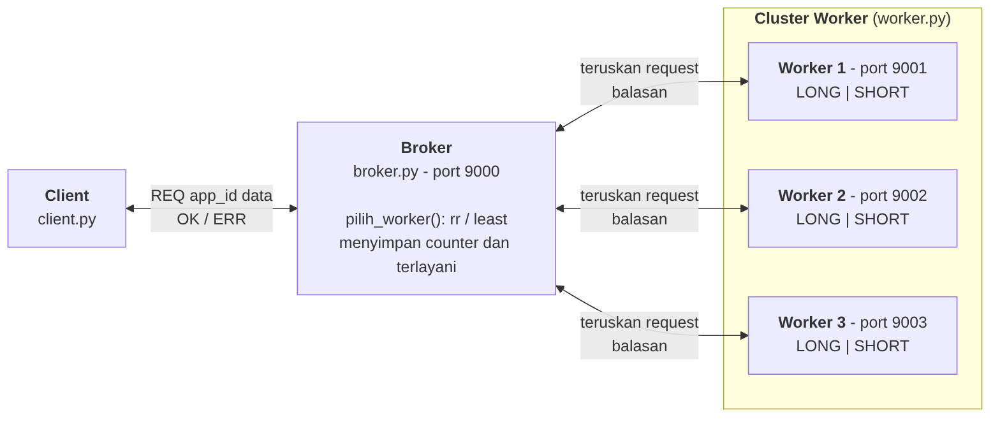
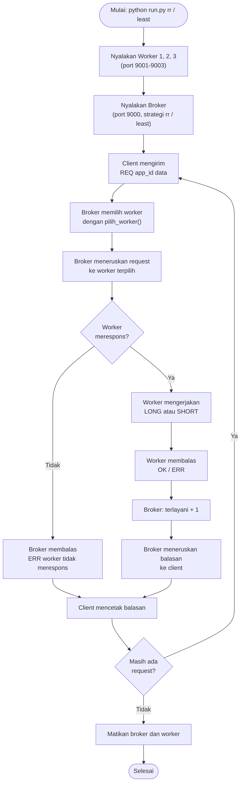
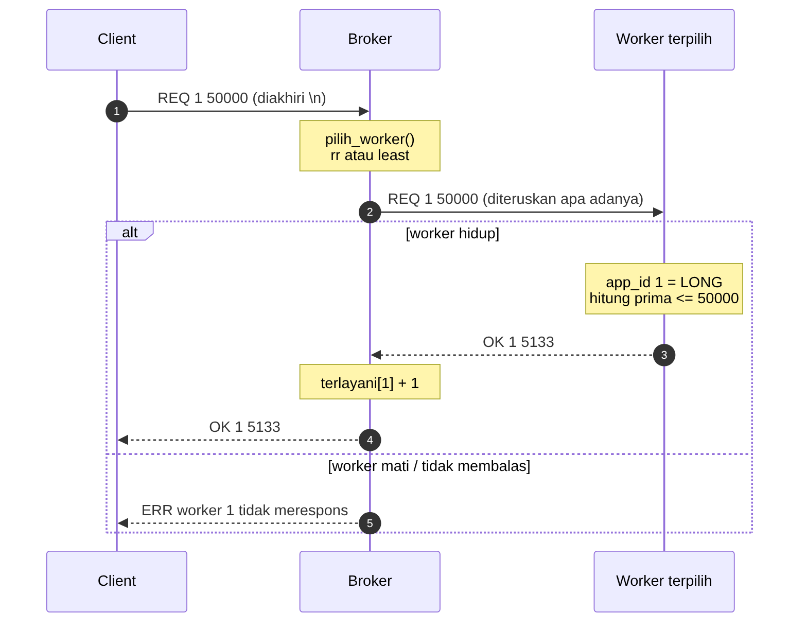
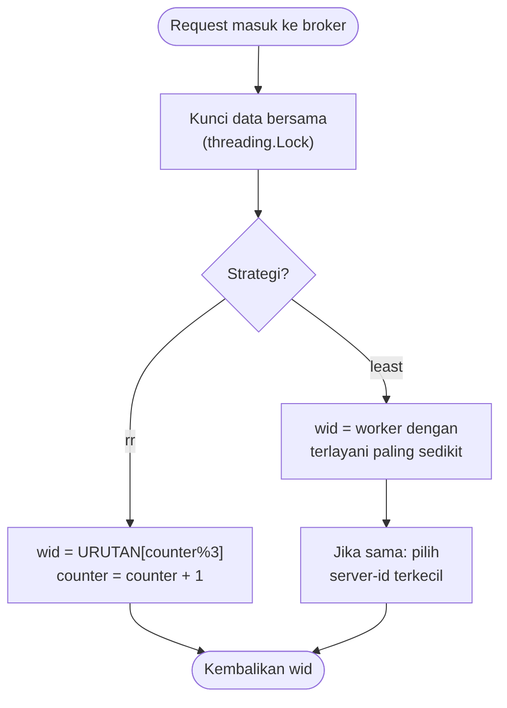
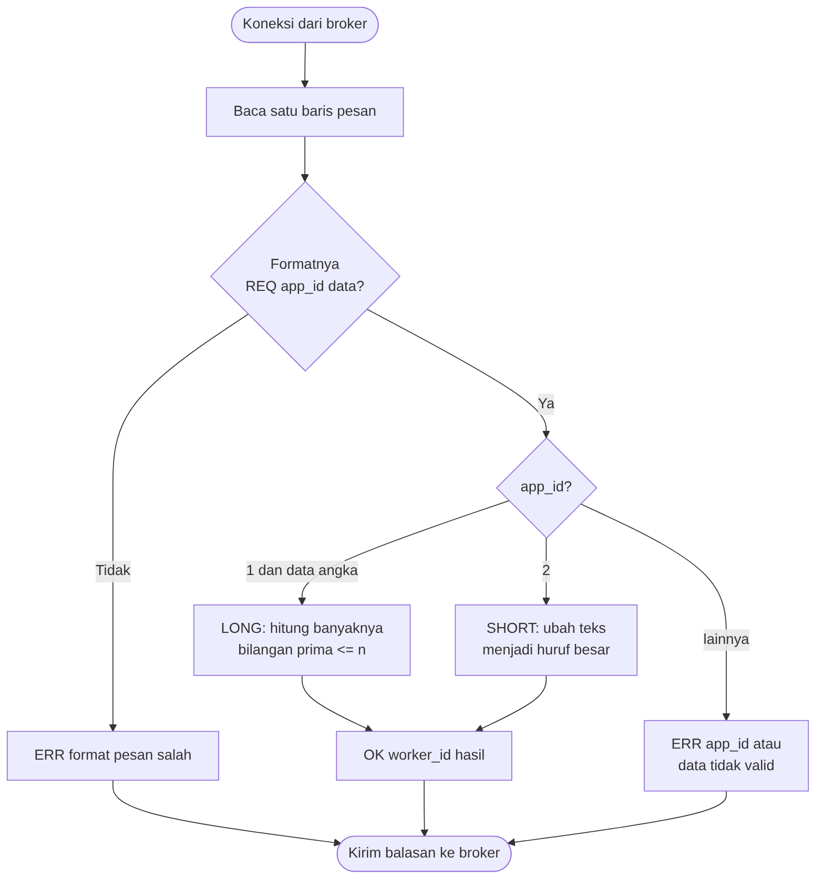
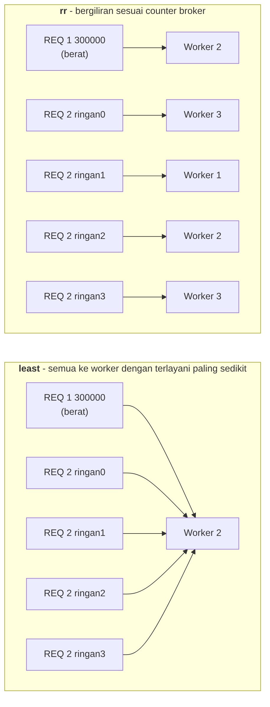

# simple-broker-worker

Tugas 1 – Socket untuk *Cluster Computing*
Mata Kuliah **Komputasi Berbasis Jaringan** – S2 Informatika UNESA

Simulasi *load balancing* sederhana dengan socket TCP di Python:
**client** mengirim request ke **broker**, broker meneruskannya ke salah satu dari **3 worker**, lalu balasan worker dikembalikan ke client.

---

## 1. Gambaran Sistem

### a. Arsitektur

Client hanya berhubungan dengan broker. Broker memilih salah satu dari 3 worker, meneruskan request, lalu mengembalikan balasannya.



### b. Diagram alir keseluruhan (`run.py`)



### c. Alur pesan untuk satu request

Nomor 1-4 adalah alur normal. Nomor 5 terjadi jika worker mati atau tidak membalas.



### d. Cara broker memilih worker (`pilih_worker()`)



### e. Cara worker memproses request



---

## 2. Isi Repositori

| File | Fungsi |
|---|---|
| `worker.py` | Server pekerja: menjalankan aplikasi LONG atau SHORT |
| `broker.py` | Server utama: memilih worker dan meneruskan request (*forwarding*) |
| `client.py` | Mengirim satu request ke broker dengan menyebutkan Application ID |
| `run.py` | Menjalankan 3 worker + broker + beberapa client sekaligus |
| `evidence/` | Log hasil percobaan |
| `docs/` | Gambar diagram (`.png`) beserta sumbernya (`.mmd`, format Mermaid) |

### `worker.py` – server pekerja

- Menerima satu baris request dari broker: `REQ <app_id> <data>`.
- Mengerjakan aplikasi sesuai Application ID:
  - `1` (**LONG**): menghitung banyaknya bilangan prima dari 2 sampai `n`. Sengaja dibuat lambat (setiap angka dicek satu per satu) agar terasa sebagai pekerjaan berat.
  - `2` (**SHORT**): mengembalikan teks dalam huruf besar (echo).
- Membalas `OK <worker_id> <hasil>`, atau `ERR <alasan>` jika format atau Application ID salah.
- Setiap koneksi dilayani oleh thread baru (`socketserver.ThreadingMixIn`), sehingga satu pekerjaan berat tidak memblokir koneksi lain.

| Argumen | Wajib | Bawaan | Arti |
|---|---|---|---|
| `--id` | ya | – | nomor worker (*server-id*) |
| `--port` | ya | – | port yang didengarkan worker |
| `--host` | tidak | `0.0.0.0` | `0.0.0.0` = bisa diakses dari komputer lain |

Contoh: `python worker.py --id 1 --port 9001`

### `broker.py` – server utama

- Menerima request dari client.
- Memilih worker tujuan lewat `pilih_worker()` sesuai strategi (lihat diagram 1c).
- Meneruskan (*forward*) request ke worker tersebut, menunggu balasan, lalu mengembalikannya ke client.
- Menambah hitungan `terlayani` hanya jika worker benar-benar membalas. Jika worker mati, client menerima `ERR worker <id> tidak merespons`.
- Data bersama (`counter`, `terlayani`) dilindungi `threading.Lock` karena diakses banyak thread sekaligus.

| Argumen | Bawaan | Arti |
|---|---|---|
| `--strategi` | `rr` | `rr` (berurutan) atau `least` (pemerataan) |
| `--port` | `9000` | port broker |
| `--host` | `0.0.0.0` | alamat yang didengarkan broker |
| `--worker` | `1=localhost:9001 2=localhost:9002 3=localhost:9003` | daftar alamat worker, format `ID=HOST:PORT` |

Contoh:
```
python broker.py --strategi rr
python broker.py --strategi least --worker 1=192.168.1.10:9001 2=192.168.1.11:9002 3=localhost:9003
```

### `client.py` – pengirim request

- Menyusun pesan `REQ <app_id> <data>`, mengirimnya ke broker, lalu mencetak balasan.
- Jika broker tidak bisa dihubungi, client mencetak `ERR koneksi ke broker gagal: ...` (bukan *traceback*).

| Argumen | Wajib | Bawaan | Arti |
|---|---|---|---|
| `--app` | ya | – | Application ID: `1` = LONG, `2` = SHORT |
| `--data` | ya | – | LONG: angka `n`, SHORT: teks |
| `--host` | tidak | `localhost` | alamat broker |
| `--port` | tidak | `9000` | port broker |

Contoh:
```
python client.py --app 1 --data 50000
python client.py --app 2 --data halo
```

### `run.py` – menjalankan semuanya sekaligus

- Menyalakan 3 worker dan 1 broker di `127.0.0.1` (agar tidak memicu peringatan firewall).
- **Tahap 1**: mengirim 7 request satu per satu, termasuk 1 request salah (`app_id 7`) untuk menguji `ERR`.
- **Tahap 2**: mengirim 5 request bersamaan (1 berat + 4 ringan) agar perbedaan `rr` dan `least` terlihat.
- Selalu mematikan worker dan broker di akhir, termasuk saat terjadi error atau Ctrl+C.

Contoh: `python run.py rr` atau `python run.py least`

---

## 3. Kesesuaian dengan Soal

| Poin soal | Implementasi |
|---|---|
| Broker menerima request client dan mendistribusikannya ke 3 worker | `broker.py`, kelas `BrokerHandler` |
| Alokasi 1: pemerataan jumlah request yang **sudah dilayani** | `--strategi least` → pilih worker dengan `terlayani` paling sedikit |
| Alokasi 2: berurutan sesuai **server-id** berdasarkan **counter broker** | `--strategi rr` → `URUTAN[counter % 3]` |
| Worker punya 2 aplikasi: Long dan Short | `worker.py`: app `1` = hitung bilangan prima, app `2` = echo huruf besar |
| Client menyebutkan Application ID, protokol didefinisikan | Lihat bagian 4 (Protokol) |
| Broker dan worker mencetak informasi ke layar | Baris log `[Broker] ...` dan `[Worker n] ...` |

---

## 4. Protokol Pesan

Semua pesan berupa **satu baris teks yang diakhiri `\n`** (*newline*). Tanda `\n` menjadi penanda akhir pesan, karena TCP adalah aliran byte dan tidak punya batas pesan sendiri.

**Request** (client → broker → worker):

```
REQ <app_id> <data>
```

| `app_id` | Nama | `data` | Hasil |
|---|---|---|---|
| `1` | LONG (perhitungan kompleks) | bilangan bulat `n` | banyaknya bilangan prima ≤ n |
| `2` | SHORT (echo) | teks bebas | teks yang sama dalam huruf besar |

**Balasan** (worker → broker → client):

```
OK <worker_id> <hasil>      jika berhasil
ERR <alasan>                jika gagal
```

| Request | Balasan |
|---|---|
| `REQ 1 50000` | `OK 1 5133` |
| `REQ 2 halo` | `OK 2 HALO` |
| `REQ 7 salah` | `ERR app_id atau data tidak valid` |
| worker mati | `ERR worker 3 tidak merespons` |

---

## 5. Konsep dari Materi yang Dipakai

| Konsep di slide | Dipakai di |
|---|---|
| Echo server/client: `bind`, `listen`, `accept`, `sendall`, `SO_REUSEADDR` | `socketserver.TCPServer` (worker, broker), `client.py` |
| `argparse` untuk argumen program | `worker.py`, `broker.py`, `client.py` |
| *Non-blocking server* thread-based: `socketserver.ThreadingMixIn` | Kelas `ThreadedServer` di `worker.py` dan `broker.py` |
| *Forwarding*: menerima koneksi lalu meneruskannya ke server lain | `BrokerHandler` di `broker.py` |

Catatan Windows: `SO_REUSEADDR` hanya diaktifkan di Linux/macOS. Di Windows, opsi ini membuat dua proses bisa mendengarkan port yang sama sekaligus, sehingga request bisa nyasar ke proses lama yang belum mati.

---

## 6. Cara Menjalankan

> Jalankan **satu percobaan dalam satu waktu**. Tunggu `run.py` selesai sebelum menjalankan yang berikutnya.

### a. Sekaligus (satu komputer)

```
python run.py rr
python run.py least
```

### b. Manual (5 terminal)

```
python worker.py --id 1 --port 9001
python worker.py --id 2 --port 9002
python worker.py --id 3 --port 9003
python broker.py --strategi rr          (atau --strategi least)
python client.py --app 1 --data 50000
python client.py --app 2 --data halo
```

### c. Di beberapa komputer (cluster sungguhan)

Misalnya worker 2 berjalan di laptop lain dengan IP `192.168.1.11`:

```
# di laptop lain
python worker.py --id 2 --port 9002

# di laptop broker
python broker.py --strategi rr --worker 1=localhost:9001 2=192.168.1.11:9002 3=localhost:9003

# client (bisa dari laptop mana saja di jaringan yang sama)
python client.py --host <IP-laptop-broker> --app 2 --data halo
```

Izinkan Python di Windows Firewall jika muncul peringatan.

---

## 7. Bukti dan Analisis

Log hasil `run.py` disimpan di folder `evidence/`:
- `evidence/hasil-rr.txt`
- `evidence/hasil-least.txt`

**Perbedaan rr dan least pada Tahap 2 (request bersamaan):**



- **rr** membagi request bergiliran ke worker 1, 2, 3, tanpa melihat apakah worker sedang sibuk.
- **least** menghitung request yang **sudah selesai** dilayani. Saat 5 request datang hampir bersamaan, belum ada yang selesai, sehingga hitungan ketiga worker masih sama. Akibatnya semua request dikirim ke worker dengan server-id terkecil.

Ini kelemahan alami dari strategi "pemerataan berdasarkan request yang sudah dilayani": strategi ini bekerja baik untuk request yang datang berurutan, tetapi tidak memperhitungkan beban yang **sedang berjalan**. Perbaikan yang umum dipakai adalah *least connections*, yaitu menghitung request yang sedang diproses.
