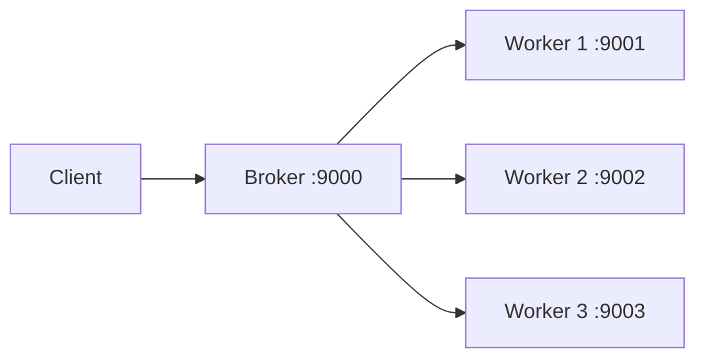
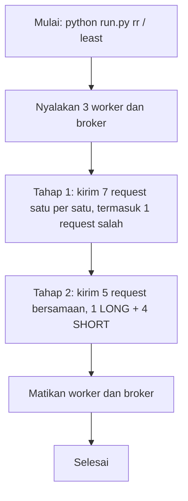
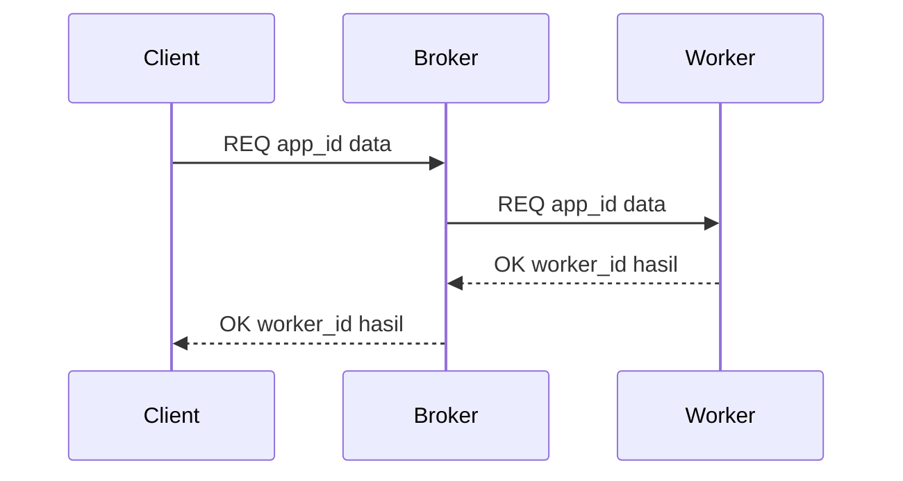
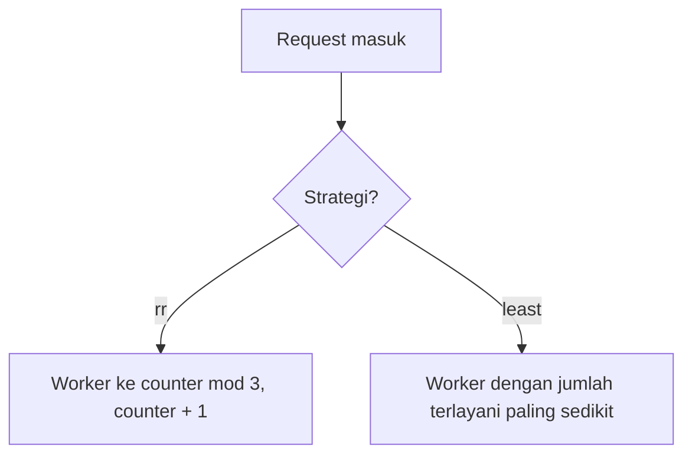

# Simple Broker-Worker (Load Balancing dengan Socket)

Tugas 1 – Komputasi Berbasis Jaringan, S2 Informatika UNESA

Client mengirim request ke **broker**, broker meneruskannya ke salah satu dari **3 worker**, lalu balasan worker dikembalikan ke client.

## 1. Arsitektur



### Alur keseluruhan (`run.py`)



Worker dan broker tetap dimatikan walaupun terjadi error atau Ctrl+C.

## 2. Alur Satu Request



Jika worker mati, broker membalas `ERR worker <id> tidak merespons`.

## 3. Strategi Pemilihan Worker



**rr (round robin)**: dibagi bergiliran sesuai server-id.
- Broker punya `counter` yang dimulai dari 0.
- Setiap request dikirim ke worker `URUTAN[counter % 3]`, lalu `counter` ditambah 1.
- Hasilnya: request ke-1 → worker 1, ke-2 → worker 2, ke-3 → worker 3, ke-4 → worker 1 lagi, dan seterusnya.
- Tidak melihat apakah worker sedang sibuk atau tidak.

**least (least served)**: dibagi rata berdasarkan jumlah request yang **sudah selesai** dilayani.
- Broker mencatat `terlayani` untuk tiap worker, yang bertambah 1 setiap worker berhasil membalas.
- Request baru dikirim ke worker dengan `terlayani` paling sedikit. Jika seri, dipilih server-id terkecil.
- Contoh: jika `terlayani` = {1: 3, 2: 1, 3: 2}, request berikutnya dikirim ke worker 2.

## 4. Protokol

Satu baris teks diakhiri `\n`.

| Arah | Format |
|---|---|
| Request | `REQ <app_id> <data>` |
| Berhasil | `OK <worker_id> <hasil>` |
| Gagal | `ERR <alasan>` |

| `app_id` | Aplikasi | Contoh |
|---|---|---|
| `1` | LONG: hitung banyak bilangan prima ≤ n | `REQ 1 50000` → `OK 1 5133` |
| `2` | SHORT: echo huruf besar | `REQ 2 halo` → `OK 2 HALO` |

**Kenapa LONG dibuat lambat?** Aplikasi LONG sengaja mengecek setiap angka dari 2 sampai `n` satu per satu (tanpa algoritma cepat seperti Sieve of Eratosthenes). Tujuannya agar LONG benar-benar menjadi pekerjaan berat yang memakan waktu, sehingga perbedaannya dengan SHORT terlihat jelas dan pengaruh strategi pembagian beban bisa diamati.

## 5. File

| File | Isi |
|---|---|
| `worker.py` | Menjalankan aplikasi LONG/SHORT (thread per koneksi) |
| `broker.py` | Memilih worker dan meneruskan request |
| `client.py` | Mengirim satu request ke broker |
| `run.py` | Menjalankan 3 worker + broker + beberapa client sekaligus |
| `evidence/` | Log hasil percobaan |

## 6. Cara Menjalankan

Sekaligus:
```
python run.py rr
python run.py least
```

Manual (terminal terpisah):
```
python worker.py --id 1 --port 9001
python worker.py --id 2 --port 9002
python worker.py --id 3 --port 9003
python broker.py --strategi rr
python client.py --app 1 --data 50000
python client.py --app 2 --data halo
```

Worker di komputer lain: `python broker.py --worker 1=localhost:9001 2=192.168.1.11:9002 3=localhost:9003`

## 7. Hasil

Log ada di `evidence/hasil-rr.txt` dan `evidence/hasil-least.txt`.

Saat 5 request dikirim bersamaan:

| Strategi | Hasil |
|---|---|
| rr | Terbagi bergiliran ke worker 1, 2, 3 |
| least | Semua ke worker 1, karena belum ada request yang selesai sehingga hitungan ketiga worker sama |

Artinya, `least` tidak memperhitungkan request yang **sedang berjalan**. Perbaikannya adalah *least connections* (menghitung request yang sedang diproses).